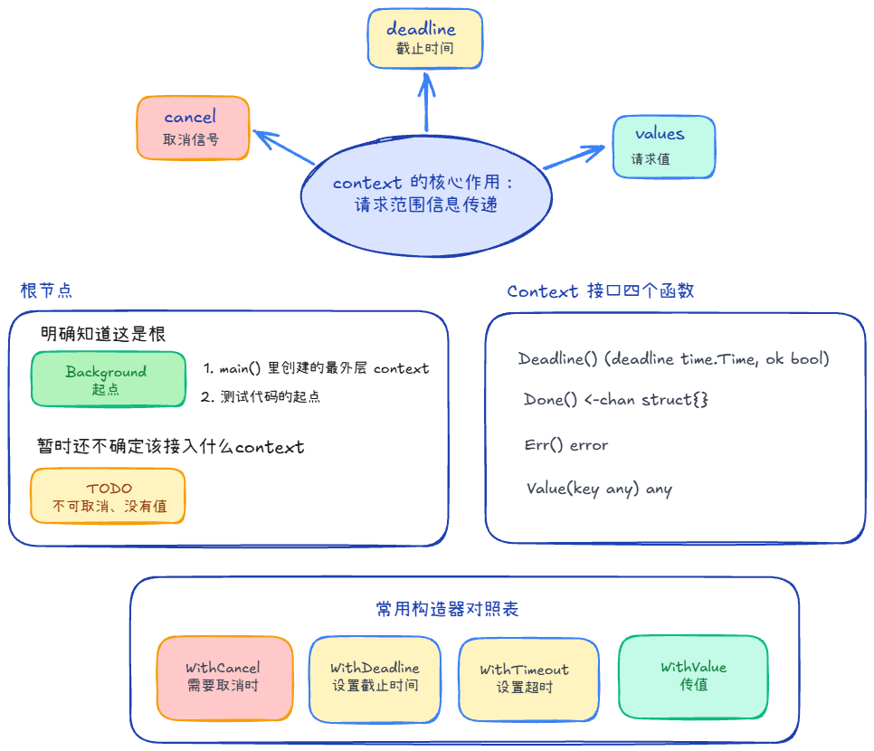
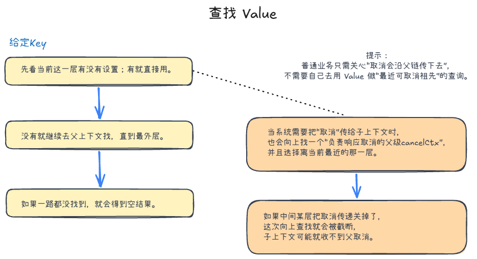
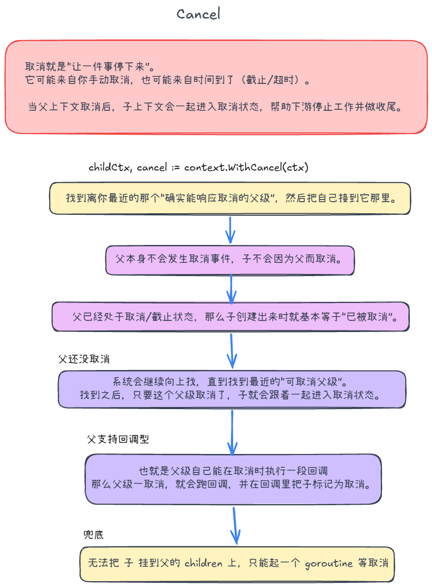

## 概念 +2



### 作用 +2
传递参数、取消信号、定时器和超时器

### 接口
| 方法 | 语义 |
|---|---|
| `Deadline() (t, ok)` | 是否设置截止时间；到点应该取消 |
| `Done() <-chan struct{}` | 只读取消通道：取消时会被 close |
| `Err() error` | 被取消后的原因（如 `context.Canceled` / `context.DeadlineExceeded`） |
| `Value(key any) any` | 从当前 context 及其父链向上查找对应 value；找不到返回 `nil` |


## 超时信号、定时器 +1

要求这个函数必须在100ms内返回，我们可以使用context的WithTimeout功能。WithTimout源码也是调用WithDeadline来实现的，里面有用time.AfterFunc

1. 起context.WithTimeout(parentCtx, 100*time.Millisecond)设置超时
2. 定义带缓冲区的channel来接收结果
3. 将真正的耗时业务丢进子协程异步执行，并传递ctx
4. 使用 select 来监听成功结果、失败、超时
	- <-ctx.Done()以及 ctx.Err()

**为什么 resChan 必须是带缓冲的**

防止GoRoutine泄漏，如果是无缓冲，那么超时之后，函数退出，就没有人监听这个Channel了。当我完成工作后，发现没人在读，就会阻塞

而带缓冲，我们直接放缓冲区里即可，协程安全销毁，不会泄露。

# value +2

## 存些什么值？ +1

适合传「整次请求、多层都要用」的鉴权/trace 这类**元数据**

不适合业务参数——因为 Value 要链式查找、返回 any 还得断言，隐式、难读、难测，业务输入应走函数参数。

## 查找 Value +1



### 普通 Value 查找：

先检查当前层的 key，匹配就返回；不匹配就沿父链向上查，直到找到或返回 `nil`。不会向子节点或兄弟节点查找，同名 key 由离当前最近的一层覆盖。

`WithValue` 创建新的一层，不修改父 context。
	- Go 的 context 是不可变的（Immutable），并且是线程安全的。但存入的 map、指针等对象不会因此自动变成并发安全。
	- 当你调用 ctx2 := context.WithValue(ctx1, key, val) 时，它并不是在 ctx1 的结构体内部加了一个键值对，而是创建了一个新的结构体（valueCtx）把 ctx1 包裹起来
	- 物理结构上是 child 包裹着 parent；逻辑概念上先有基础后有衍生，基础是父，衍生是子。

### 取消传播的内部查找：

标准库通过内部 key 寻找最近的 `cancelCtx`，并检查它是否对应父 context 的 Done 通道，决定能否直接登记子节点。业务代码不需要调用 Value 寻找这个节点。

普通 `WithValue` 会继续传递父节点的取消信号；`WithoutCancel` 等隔离取消的上下文不会沿原父链传播取消。对于自定义 context，若 Done 与内部取消节点不匹配，标准库会采用后面的其他关联方式。

# 取消 Cancel +1

## 传播取消信号流程



`child, cancel := context.WithCancel(parent)` 创建子 context 和取消函数。

1. **父节点不会取消**：`parent.Done()` 为 nil，不需要建立监听关系。子节点仍可以通过自己的 cancel 取消。
2. **父节点已经取消**：立即取消新建的子节点。
3. **可以找到对应的 cancelCtx**：将子节点登记到父节点的 `children` 集合。登记时会再次检查父节点是否已取消，避免并发竞态。
4. **父节点支持 AfterFunc 回调**：注册回调，父节点取消后由回调取消子节点。
5. **以上方式都不适用**：启动一个 goroutine，同时等待父、子 Done。父取消就取消子；子先取消则结束监听。

### 调用 cancel 后发生什么？

记录取消原因，关闭当前 context 的 Done 通道，再取消关联的子节点，并清理关联关系。重复调用 cancel 是安全的；超时 context 取消时还会停止相关定时器。

**取消只向下传播。**取消父节点会影响通常由它派生的子孙节点；取消一个子节点，不会取消父节点或兄弟节点。WithValue 不隔离取消，WithoutCancel 则明确切断这种传播。

### 业务怎么感知取消？

监听 `<-ctx.Done()` 或检查 `ctx.Err()`。Done 关闭代表取消通知；Err 返回 Canceled 或 DeadlineExceeded 等原因，未取消时返回 nil。

```go
select {
case <-ctx.Done():
    return ctx.Err()
case result := <-results:
    return handle(result)
}
```

cancel 不会强行终止 goroutine，也不会自动关闭业务的 jobs、results 通道。耗时循环需要主动检查取消；已进入且不支持 context 的阻塞操作，也不会仅因 cancel 立即退出。取消函数本身不等待业务协程完成，收尾仍需 WaitGroup 等同步机制。

