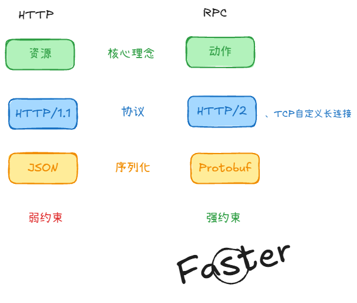

## 什么是RPC

RPC（Remote Procedure Call，远程过程调用）是一种远程调用方式，不是某一种固定的传输协议。它让调用方以类似本地函数的形式调用远端服务，但网络超时、重试和远端故障仍需显式处理。

## gRPC呢？

gRPC 是 Google 开源的 RPC 框架，默认 HTTP/2 + Protobuf。一份 `.proto` 能生成多种语言的客户端/服务端，所以能跨语言调用。

## 四种 gRPC 调用模型

gRPC 不只有“请求一次、返回一次”，服务方法在 `.proto` 中可定义为四种模型：

1. **一元 RPC（Unary）**：最常用，适合查询照片、创建任务等普通请求/响应场景。
2. **服务端流（Server streaming）**：适合订阅任务进度、日志或持续推送结果；客户端发完一个请求后持续读取服务端消息。
3. **客户端流（Client streaming）**：适合分片上传文件、批量上报数据；客户端写完多条消息后，服务端统一处理并返回结果。
4. **双向流（Bidirectional streaming）**：适合实时聊天、协同编辑或持续交互；客户端和服务端可以各自独立地读写消息。

同一个流中的消息顺序由 gRPC 保证；不同 RPC 之间不应假定存在全局顺序。

## gRPC Metadata

Metadata 是附着在**一次 RPC 调用**上的键值对，类似 HTTP Header，但不属于 `.proto` 定义的业务消息。它通常随请求或响应的 Header 发送，服务端还可以在调用结束时通过 Trailer 返回附加信息。

- 适合放鉴权凭证、TraceID、请求 ID、租户标识、灰度标记等跨接口通用信息。
- 业务字段，例如 `photo_id`、文件内容、任务参数，仍应放在 Protobuf message 中，不能借 Metadata 绕开接口契约。
- Metadata 的 key 是字符串；二进制值通常使用以 `-bin` 结尾的 key。`grpc-` 前缀由 gRPC 保留，业务方不能使用。

## gRPC + Protobuf 与 REST 风格 HTTP API + JSON 对比

| 维度 | gRPC + Protobuf（RPC 阵营） | HTTP + JSON / REST（通用网络阵营） |
| :--- | :--- | :--- |
| **设计哲学** | **面向过程 / 动作**（像调用本地函数一样调远程方法） | **面向资源 / 统一接口**（也可灵活设计成动作/RPC 风格） |
| **传输协议** | **HTTP/2（或 TCP / IPC）**：原生支持多路复用、双向流式通信，支持 UDS 本机进程通信 | **HTTP/1.1、HTTP/2 或 HTTP/3**：以请求-响应为主，流式通常依赖 SSE/WebSocket 或分块传输 |
| **数据序列化** | **Protobuf（二进制）**：编码体积更小、编解码更快、更节省带宽和 CPU | **JSON（文本格式）**：人类直观可读，但体积较大、解析性能相对较弱 |
| **契约约束** | **硬契约（强类型代码生成）**：以 `.proto` 为单一数据源，自动生成多语言客户端/服务端代码，编译期暴露不兼容问题 | **软/半强契约（依赖规范与文档）**：契约约束强弱依赖团队规范（如 OpenAPI/Swagger 生成代码），容错高但易出现运行时隐患 |
| **功能特性** | **内建原生支持**：开箱即用的 Deadline/超时控制、请求取消（Cancellation）、标准状态码与流式调用 | **依赖应用层实现**：需自行在请求头或中间件中约定超时、追踪等元数据协议 |
| **开发与排障** | **依赖工具链**：对机器友好。需提前编译生成 Stub 代码，抓包与手工调试依赖专用工具（如 grpcurl） | **极度灵活直观**：对人友好。浏览器、curl、Postman、脚本随手可调，抓包与排障门槛极低 |
| **适用场景** | **内部服务与高性能基建（东西向）**：微服务内网 RPC、高吞吐/低延迟服务、同机 IPC、跨团队强契约协作 | **开放生态与终端交互（南北向）**：Web 浏览器端、对外开放 API、调用方技术栈杂乱、数据结构频繁变化的场景 |

## RPC 的核心工作流程

你写业务时调的是本地函数，真正发出去的是 Stub：

1. Client Stub：方法名 + 参数 → 序列化 → 丢给网络
2. Server Stub：字节流 → 反序列化 → 调本地真正的实现
3. 结果原路回来，Client Stub 拆成 resp 给你
